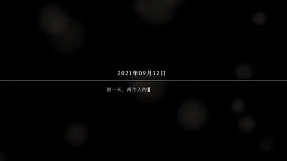

<h3>换上照片和文案，就是一部新片； 给一部喜欢的片子，复刻出你自己的版本。</h3>

[官网](https://vibevision.video/zh/) · [English](README.en.md) · [开始使用](docs/getting-started.md) · [模板](docs/templates.md) · [社区模板](https://vibevision.video/zh/community/) · [文档](docs/README.md)

> [!NOTE]
> **仅供学习与研究。** 本项目用于学习和研究可复用的视频模板、节拍剪辑与 Agent 工作流。示例中的新人和照片均为虚构。复刻参考视频是为了学习它的结构与节奏，请勿搬运或冒充他人作品；照片、音乐和字体请确认你有权使用。

## 用模板做出来的片子

<table>
  <tr>
    <td align="center" width="33%"> <b>Doodle</b> · 白纸手绘</td>
    <td align="center" width="33%"> <b>Album</b> · 留白画册</td>
    <td align="center" width="33%"> <b>DV Story</b> · DV 回放</td>
  </tr>
  <tr>
    <td align="center"> <b>Comedy</b> · 喜剧开场</td>
    <td align="center"> <b>Starter</b> · 节拍相册</td>
    <td align="center"> <b>Album 9:16</b> · 竖版短片</td>
  </tr>
  <tr>
    <td align="center"> <b>Editorial</b> · 简约杂志</td>
    <td align="center"> <b>Cinema</b> · 黑幕影院</td>
    <td align="center"> <b>Memoir</b> · 手写胶片故事</td>
  </tr>
</table>

点击动图观看带配乐的完整预览。全部由模板直接渲染并通过 <code>vvv check</code>，新人和照片均为虚构示例。最新加入的 <b>Editorial</b>、<b>Cinema</b> 和 <b>Memoir</b> 都从参考片复刻：简约杂志风婚礼 MV、现场大屏黑底开场片、手写胶片人生故事。<a href="docs/templates.md">全部模板、画幅与风格</a>

## 从一堆照片到一部成片

把照片和想法交给 Agent，从整理照片到渲染成片，每一步它都能接手。你只需要说想法、看样片、拍板。

<table>
  <tr>
    <th width="25%">准备照片</th><th width="25%">理清想法</th><th width="25%">样片与修改</th><th width="25%">成片与保存</th>
  </tr>
  <tr>
    <td valign="top"><b>01 说想法</b> 告诉 Agent 想要的风格、画幅和歌曲，一两句话就够。</td>
    <td valign="top"><b>04 理需求</b> 整理风格、画幅、时长和歌曲。点名的歌用你手里的音乐文件，或由你自装的 musicdl 获取（仅限个人使用）。</td>
    <td valign="top"><b>07 出样片</b> 配乐自动对齐：副歌落在高潮页，渲染前先告诉你全片多长、每页停几秒。</td>
    <td valign="top"><b>10 出成片</b> 渲染 1080p 高清成片，自动检查画幅、音量、静止画面和卡点。</td>
  </tr>
  <tr>
    <td valign="top"><b>02 放照片</b> 照片放在本地文件夹，或给一个百度网盘分享链接。</td>
    <td valign="top"><b>05 看照片</b> 逐张识别人物、情绪和服装，按套分组；同一页用同一套，相邻两组自动换装。</td>
    <td valign="top"><b>08 提意见</b> 看完样片，直接说哪里要改。</td>
    <td valign="top"><b>11 存网盘</b> 需要时把成片存进你的百度网盘，经你确认才上传。</td>
  </tr>
  <tr>
    <td valign="top"><b>03 取照片</b> Agent 下载原图，自动缩到渲染尺寸，原图不动。</td>
    <td valign="top"><b>06 定方案</b> 三选一：推荐最合适的模板、用你指定的模板，或学习一部你喜欢的参考视频的结构和节奏，用自己的素材复刻（抖音、小红书、快手链接直接用）。</td>
    <td valign="top"><b>09 改到位</b> 换照片、改文案、调节奏，逐条修改，只重渲改动的部分。</td>
    <td valign="top"><b>12 留工程</b> 可编辑工程一并留存，以后随时能改，也能交给另一个 Agent 接着做。</td>
  </tr>
</table>

> 用 vvv 技能做一部婚礼 MV：照片在百度网盘 https://pan.baidu.com/s/…（提取码 abcd），歌用《咱们结婚吧》，风格参考这条小红书 https://xhslink.cn/o/…。新郎林以舟、新娘许知夏，10 月 18 日结婚。先给我看样片。

## 装进你的 Agent

任选一种：

| Agent | 安装 |
|---|---|
| **Claude Code** | `/plugin install vvv --marketplace actionow-ai/vvv`（插件里已包含模板库） |
| **Codex、Cursor、Gemini CLI、Copilot 等 20 多个** | `npx skills add actionow-ai/vvv`（再 clone 本仓库，并设置 `VVV_KIT`，[说明](docs/agent-compatibility.md)） |
| **WorkBuddy** | 从 [Releases](https://github.com/actionow-ai/vvv/releases) 下载技能 ZIP，在「技能 → 添加技能」中上传（[说明](docs/workbuddy.md)） |
| **任何 MCP 客户端** | `claude mcp add --transport http vvv https://mcp.vibevision.video/mcp`，无需安装即可浏览模板和方法指南 |

渲染在你的电脑上进行，需要装好 Python 3.9+、Node.js 26 和 npm；其余依赖由 Agent 安装。可选（用你自己的账号）：下载分享链接参考片用的 [TikHub](https://tikhub.io) Token、百度网盘登录、musicdl（[集成说明](docs/integrations.md)）。

## 一个模板，做每一部新片

场景、版式、节奏和检查只做一次。新片只改属于它自己的东西。

<table>
  <tr><td><b>只做一次</b></td><td>场景结构与镜头运动 · 16:9 与 9:16 版式 · 按节拍规划的时间线 · 渲染检查</td></tr>
  <tr><td><b>每部片子各自修改</b></td><td>照片 · 名字和日期 · 每一句文案 · 配乐与画幅</td></tr>
</table>

`vvv.py describe` 告诉 Agent 每个模板的照片位、可改文案和配置，`validate` 在渲染前拦下错误输入。Agent 优先改模板开放的输入，只有需求需要时才动 React/TypeScript 源码。复用模板是为了省下反复设计、生成和调试同类视频代码的 token；对照基准尚未发布，见[路线图](ROADMAP.md)。

## 给它一部你喜欢的片子，做出你自己的。

把参考视频和属于你的附件交给 Agent：照片、Logo、文案、音乐。它会拆解参考片为什么好看，再用你的素材重建成一个可编辑的工程。

<table>
  <tr>
    <td width="33%" valign="top"><b>01 参考视频 + 附件</b> 一个视频文件，或抖音、小红书、快手、TikTok 的分享链接，加上你的照片（本地或百度网盘）、Logo、文案和音乐。参考片只用来学习，不会被打包分发。</td>
    <td width="33%" valign="top"><b>02 逐页清单</b> 按节拍列出每一页：每个转场按 0.1 秒密集截帧，从定格帧量出照片框坐标，写清每个元素怎么进、怎么出。清单确认后才开始写代码。</td>
    <td width="33%" valign="top"><b>03 重建并对照</b> 基于最接近的模板或全新的构图。缺的素材以参考截图为风格参考生成；新旧画面并排对照，偏离节拍的峰值逐个列出。</td>
  </tr>
</table>

> 用 vvv 技能把这条小红书视频 https://xhslink.cn/o/… 复刻成我们自己的片子：用 ./photos 里的照片、我们的 Logo 和文案重建，缺的画面素材用生图补上，正式渲染前先给我看检查过的样片。

有生图能力的 Agent 效果最好。本机同时装有 Claude Code 和 Codex 时，Claude Code 可以通过内置桥接调用 Codex 的生图能力。不生成视频和配音。[复刻流程](docs/capabilities.md#recreate-a-reference-video)

## 还能做什么

- **按情绪线排照片**：每个模板都标好了自己的情绪段落（先笑后泪、从相识到婚礼）。Agent 先看每张照片，标出人物、情绪和时间，再按段落放进对应位置，渲染前先给你看排好的顺序。
- **风格预设**：片头规则、配乐、署名这些定一次存成预设，之后每部片子都直接沿用，不用每次重新交代。
- **渲染检查**：`vvv check` 测量画幅、音量、静止画面和卡点，直接点出偏离节拍最多的几个画面，并列出只能由人判断的事项。
- **模板更新**：`vvv.py update` 把已有工程的模板代码更新到 kit 的最新版本，保留你自己改过的部分。
- **交接**：把模板、动效或做好的工程打包成一个 [`.vvv` 文件](docs/format/vvv-1.0.md)，带上代码、素材授权和渲染验证记录，换一个 Agent 也能接着做。
- **素材工具**：本地 FFmpeg 工具可以探测媒体、截取片段、提取音轨和抽帧（[示例](examples/media-workflow.md)）。
- **社区模板**：做了满意的模板，打包后在[官网投稿](https://vibevision.video/zh/submit/)。站长审核通过后，它会出现在网站和 MCP 服务里。

Agent 第一次在你的电脑上运行命令时，可能会先征求你的同意。想手动运行或开发新模板，见[开始使用](docs/getting-started.md)和[贡献指南](CONTRIBUTING.md)；现成的 `.vvv` 模板包附在 [Releases](https://github.com/actionow-ai/vvv/releases) 中。

### 今天就做出你的第一部片子。

[开始使用](docs/getting-started.md) · [官网](https://vibevision.video/zh/) · [contact@vibevision.video](mailto:contact@vibevision.video) · [Linux.do](https://linux.do)

<table>
  <tr>
    <td width="33%" valign="top"><b>状态</b> 0.1 早期版本。已在 macOS ARM64 上用 Claude Code 和 Codex 完整验证，WorkBuddy 和其他平台测试较少。<a href="docs/verification.md">验证与限制</a></td>
    <td width="33%" valign="top"><b>用途与许可</b> 仅供学习与研究。代码、文档、模板与演示素材采用 <a href="LICENSE">MIT</a>；字体、预览配乐和第三方代码沿用各自条款，其中 musicdl 仅限非商业使用：<a href="MEDIA_LICENSE.md">媒体许可</a> · <a href="THIRD_PARTY_NOTICES.md">第三方说明</a></td>
    <td width="33%" valign="top"><b>参与</b> <a href="CONTRIBUTING.md">贡献指南</a> · <a href="ROADMAP.md">路线图</a> · <a href="CHANGELOG.md">更新记录</a> <a href="SECURITY.md">安全</a> · <a href="docs/brand.md">品牌素材</a> · <a href="https://vibevision.video/zh/submit/">投稿模板</a></td>
  </tr>
</table>

© 2026 Vibe Vision Video contributors · <a href="https://vibevision.video/zh/">vibevision.video</a>

