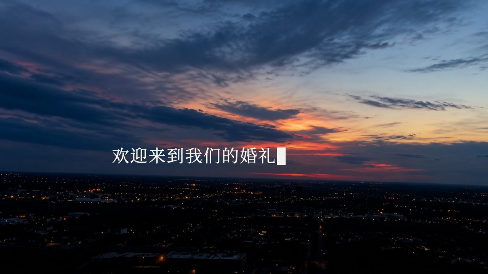

# Templates

VVV currently ships eight editable Remotion templates, all wedding films, and one reusable effect. List them with `vvv.py templates --kit kits/remotion`, see one template's inputs with `vvv.py describe --kit kits/remotion --template ID`, and choose the template and format at `init`. Each published preview is the complete film, at 960 × 540 (Album 9:16: 540 × 960; Starter: 1280 × 720), and passes `vvv check` for audio, still stretches and beat alignment; that does not certify every frame.

| Template | What it makes | Formats | Published preview |
|---|---|---|---|
| Doodle · 我们结婚啦 | Marker doodles on white paper, photo pages gliding across it | 16:9 | 1.5–24.5 s opening: heart, record card, avatars, first photo pair |
| Album · 现代留白·圆角画册 | The couple's story in rounded-card spreads, then a beat-cut gallery | 16:9, 9:16 | 3–26.73 s (16:9); 26–48.6 s of the 49.8 s short, ending on the closing card (9:16) |
| DV Story · 我们的故事 | Typed welcome, camcorder childhood, PLAY love story, 35 mm wedding strip | 16:9 | 70–90 s typed lines to the first photo pages |
| Comedy · 喜剧开场 | Host-voice gags, house rules, the 99% love bar, red-and-gold gallery, applause countdown | 16:9 | 62.6–76.9 s complete groom gag |
| Starter · 节拍相册 | A short beat-cut photo reel for a fast first render | 16:9, 9:16 | Full 34.9 s reel (16:9) |
| Editorial · 简约留白 · 杂志婚礼 MV | Clean magazine spreads on white paper: handwritten cover, round-portrait invitation, poems, heart reveal, growing columns | 16:9 | 4.2–26 s cover, invitation, poem and first spreads |
| Cinema · 黑幕影院 · 婚礼开场 | A venue-screen opener on black: typed welcome over a dusk sky, childhood portraits with birthdays, a day counter, dating photos panel by panel, a line drawing of the couple | 16:9 | 28–52 s date line opening into the first photo, the counter, the first panels |
| Memoir · 手写胶片故事 · 婚礼开场 | The couple's life story in a pen hand on black: stickers of hometowns and childhood faces, a scrolling 35 mm strip, chats, chapters, the licence in a viewfinder, a letter | 16:9 | 13.6–40 s couple sticker, hometown and childhood stickers, the film strip |

All examples use fictional couples and photographs. Replace the fixture inputs with your own licensed media and review the contact sheet before rendering.

## Choose a direction

| Direction | Start from | What to inspect |
|---|---|---|
| Editorial album | Album | Photo order, names and dates, portrait crops, page-turn contrast and the closing card |
| Hand-drawn photo story | Doodle | Paper texture, doodle timing, poem readability and the transitions between photo pages |
| Camcorder memory film | DV Story | Typed messages, viewfinder framing, the PLAY transition, photo-page rhythm |
| Comedy opener | Comedy | Narration timing, gag clarity, clip rights, captions, sound effects and the countdown |
| Clean magazine MV | Editorial | Photo crops in each spread, poem and caption length, handwritten titles, the white sweep between pages |
| Life story before the ceremony | Memoir | Cut-out stickers (transparent PNGs work best), childhood photos on the strip, chapter titles, the letter's length |
| Ceremony opener on the venue screen | Cinema | Birthdays and the day you met, childhood photos, typed lines at screen distance, the counter, the closing thanks |
| Fast first reel | Starter | One clear beat per photo, readable names, framing per format and a complete ending |

State who the film is for, which memories matter, the format, the available photos or footage, music rights and the moment that should close the story. Choose the template whose scene structure already matches, then change the source only where the story needs it.

## Doodle

[](assets/doodle.mp4)

[Watch the full film](assets/doodle.mp4) · [Inputs](../kits/remotion/examples/doodle-wedding.json) · [Scene source](../kits/remotion/src/templates/doodle/scenes.tsx)

White watercolor paper and black marker doodles: a pink heart blooms behind "We're married!", the couple dances in, a record card rolls past, doodle avatars introduce them, nine pages of photos glide across the paper, and the couple bows to "THANK YOU FOR COMING". The default track *Dance with Me* is download-only (`npm run music`). Composition: `VVV-Doodle`.

## Album

[](assets/album.mp4)

[Watch 16:9](assets/album.mp4) · [Watch 9:16](assets/album-vertical.mp4) · [Inputs](../kits/remotion/examples/album-wedding.json) · [Scene source](../kits/remotion/src/templates/album/)

The 16:9 film needs 40 story photos plus its gallery. The 9:16 short uses only the opening, gallery and ending photos; with the demo's twelve gallery shots it runs 49.8 s, and fewer shots make it shorter. Album uses *Skyline* (download-only); run `npm run music` or point `music.src` at your own track and beat map. Composition: `VVV-Album`.

## DV Story

[](assets/dv-story.mp4)

[Watch the full film](assets/dv-story.mp4) · [Inputs](../kits/remotion/examples/dv-our-story.json) · [Template notes](../kits/remotion/src/templates/dv-story/README.md)

Typed welcome lines, a camcorder viewfinder, a PLAY screen, sticker cards, photo pages, a 35 mm wedding strip and a typed last line. The default track is *Fifth of February* (download-only). Composition: `VVV-DVStory`.

## Comedy

[](assets/comedy.mp4)

[Watch the full film](assets/comedy.mp4) · [Inputs](../kits/remotion/examples/comedy-wedding.json) · [Template notes](../kits/remotion/src/templates/comedy/README.md)

A Chinese comedy opener with host narration, house-rule gags, a wrong-clip record scratch, a bride reveal, the 99% love bar, red-and-gold photos and an applause countdown. Music and effects are download-only (`npm run music`). Composition: `VVV-Comedy`.

## Starter

[](assets/starter.mp4)

[Watch the reel](assets/starter.mp4) · [Inputs](../kits/remotion/examples/starter-reel.json) · [Template notes](../kits/remotion/src/templates/starter/README.md)

The smallest beat-cut photo reel, cut to the bundled public-domain *Maple Leaf Rag*, so it renders without a music download. Use it for a first render or as a clean base for a custom reel. Composition: `VVV-Starter`.

## Editorial

[](assets/editorial.mp4)

[Watch the full film](assets/editorial.mp4) · [Inputs](../kits/remotion/examples/editorial-wedding.json) · [Template notes](../kits/remotion/src/templates/editorial/README.md)

A clean wedding MV in fourteen white magazine spreads, about 85 s: handwritten cover title, two round portraits on an invitation with a drawn ribbon, photos beside poems, a heart that opens onto a full-bleed photo, three columns growing to full height, a 囍 page, a handwritten "浪漫主义者" and a closing vow. Each spread lasts 8 or 16 beats of the measured beat map and leaves under a sweep of soft white discs. Music is download-only (`npm run music`). Composition: `VVV-Editorial`.

## Cinema

[](assets/cinema.mp4)

[Watch the full film](assets/cinema.mp4) · [Inputs](../kits/remotion/examples/cinema-wedding.json) · [Template notes](../kits/remotion/src/templates/cinema/README.md)

A wedding opening film for the venue screen, on black, about 1 min 55 s: the welcome typed with a block caret over a dusk sky, two rounded childhood portraits with names and birthdays, four childhood photos sliding into a row, the day they met drawn as a line that opens into their first photo, a counter running up to the days together, dating photos filling the screen panel by panel, the wedding, a typed line of the couple's own, and a line drawing of the couple with thanks. Recreated from the structure of a reference film; every page lasts 8, 12 or 16 beats of the measured beat map. Music is download-only (`npm run music`). Composition: `VVV-Cinema`.

## Memoir

[](assets/memoir.mp4)

[Watch the full film](assets/memoir.mp4) · [Inputs](../kits/remotion/examples/memoir-wedding.json) · [Template notes](../kits/remotion/src/templates/memoir/README.md)

The couple's life story in a pen hand on black, about 2 min 35 s: a typed welcome, photos in a scanned film frame with two quotes, the couple as a die-cut sticker under confetti, their hometowns and childhood faces as stickers with handwritten names and arrows, a scrolling 35 mm strip of childhood photos, the chats that introduced them, four chapters, the licence in a camera viewfinder, four "what love is" pages, a letter and thanks. Transparent PNGs become die-cut stickers with a white border and a coloured line; ordinary photos become cards with the same outline. Recreated from the structure of a reference film; every page lasts 8, 12, 16 or 32 beats of the measured beat map. Music is download-only (`npm run music`). Composition: `VVV-Memoir`.

## Effects

Effects are reusable motion pieces. The kit includes `papercut-frame`, the red page and gold paper-cut corners used by Comedy. List effects with `vvv.py effects --kit kits/remotion`; its notes are in [`src/effects/papercut-frame/`](../kits/remotion/src/effects/papercut-frame/README.md). Add a packaged effect to a project with `vvv.py add --project P --effect papercut-frame.vvv`.

## Templates as .vvv packages

Each template and effect can be published as one [.vvv file](format/vvv-1.0.md) with its code, redistributable fonts, assets, demo photos and optional preview and render evidence. Packages for this release are attached to [GitHub Releases](https://github.com/actionow-ai/vvv/releases); to build one yourself:

```sh
python3 skills/vvv/scripts/vvv.py pack --kit kits/remotion --template album --output .work/album.vvv \
  --preview docs/assets/album.mp4 --poster docs/assets/album.jpg
python3 skills/vvv/scripts/vvv.py verify --package .work/album.vvv
python3 skills/vvv/scripts/vvv.py init --template .work/album.vvv --format 9:16 \
  --photos ./my-photos --output ./my-album
```

Music that may not be redistributed stays out of the package and is fetched with `npm run music`.

## Reproduce the gallery

From `kits/remotion`, after `npm ci`:

```sh
npm run music -- --all
npx remotion render examples/cases.tsx VVV-Doodle out/doodle.mp4 --frames=45-734
npx remotion render examples/cases.tsx VVV-Album out/album.mp4 --frames=90-801
npx remotion render examples/cases.tsx VVV-Album-Vertical out/album-vertical.mp4 --frames=780-1457
npx remotion render examples/cases.tsx VVV-DVStory out/dv-story.mp4 --frames=2100-2699
npx remotion render examples/cases.tsx VVV-Comedy out/comedy.mp4 --frames=1878-2306
npx remotion render examples/cases.tsx VVV-Starter out/starter.mp4
npx remotion render examples/cases.tsx VVV-Editorial out/editorial.mp4
npx remotion render examples/cases.tsx VVV-Cinema out/cinema.mp4
npx remotion render examples/cases.tsx VVV-Memoir out/memoir.mp4
```

The published previews are complete films. Album, Comedy, Doodle and DV Story were rendered in full on 2026-10-23 at half scale and encoded as H.264 high profile, CRF 28, with the rendered AAC 128 kbps audio; Starter's full 35-second reel is the 2026-10-21 render at 1280 × 720; Editorial was rendered in full on 2026-10-29 and Cinema and Memoir on 2026-10-30, the same way as the 2026-10-23 set. Commands, hashes and check results are in [preview metadata](assets/previews.json) and the validation records ([2026-10-23](assets/preview-validation-2026-10-23.json), [2026-10-29](assets/preview-validation-2026-10-29.json), [2026-10-30](assets/preview-validation-2026-10-30.json)); review notes are in [verification](verification.md#preview-review). Demo photo provenance is in [assets.json](../kits/remotion/assets.json); see [media licensing](../MEDIA_LICENSE.md).
